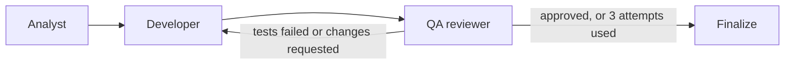

# AgentForge

**An experimental multi-agent AI system that plans, implements, and reviews code changes in a local Git repository.**

You give AgentForge a repository and a task in plain English. Three specialised AI agents then work through it the way a small engineering team would: an **Analyst** studies the code and writes a plan, a **Developer** edits the code, writes tests, and runs them, and a **QA reviewer** runs the test suite, reviews the diff, and either approves the work or sends it back with feedback.

> [!WARNING]
> **AgentForge is experimental.** It is a learning and research project, not a production tool. The agents edit files in your repository and run its test suite on your machine. Only use it on repositories you trust, and always review the changes before you keep them. See [Limitations and security](#limitations-and-security).

## How it works



| Agent | What it does | Tools it can use |
|---|---|---|
| **Analyst** | Reads the relevant files and writes an implementation plan, a testing plan, and the risks. It never modifies anything. | `read_file` |
| **Developer** | Implements the plan: reads files, writes changes and tests, runs the tests, and fixes failures. On a retry it receives QA's feedback from the previous attempt. | `list_files`, `read_file`, `write_file`, `run_tests`, `git_diff` |
| **QA reviewer** | Runs the full test suite, reads the complete diff, and reviews correctness, test coverage, edge cases, compatibility, maintainability, error handling, security, and performance. It returns a structured verdict: `APPROVED` or `CHANGES_REQUESTED`. | None. It runs the tests and the diff itself and cannot edit code. |

The workflow finishes when the tests pass **and** QA approves, or after 3 Developer attempts. It then reports `SUCCESS`, or `FAILED` with the reason (for example, "tests failed (pytest exit code 1); QA requested changes").

### Design notes

- **Orchestration** is a [LangGraph](https://github.com/langchain-ai/langgraph) state graph with fixed routing. The agents share one typed state object (`graph/state.py`).
- **Tool use:** `agents/tool_loop.py` runs each agent's loop: the LLM requests a tool call, the tool runs, and the result goes back to the LLM until it gives a final answer. The loop has a step limit, caps the size of tool output, and returns tool errors to the model instead of crashing.
- **Decisions don't depend on parsing text:** test results come from pytest's exit code, and the QA verdict is a structured output (a Pydantic model), not a keyword search.
- **Safe starting point:** AgentForge refuses to run unless the target repository's working tree is clean. That way the final diff contains only the agents' changes, and they can be reverted.
- **Sandboxed file access:** file reads and writes are restricted to the target repository.

## Project structure

```
AgentForge/
├── main.py              # CLI entry point: checks the repo, runs the workflow, prints results
├── config.py            # LLM setup and API key loading (.env or environment variable)
├── agents/
│   ├── analyst.py       # Analyst agent (read-only)
│   ├── developer.py     # Developer agent (edits code, runs tests)
│   ├── qa.py            # QA reviewer (runs tests, structured verdict)
│   └── tool_loop.py     # Shared tool-calling loop used by the Analyst and Developer
├── graph/
│   ├── state.py         # Shared workflow state (AgentState)
│   └── workflow.py      # LangGraph wiring, retry routing, final status
├── tools/
│   ├── filesystem.py    # list_files, read_file, write_file (restricted to the repo)
│   ├── git.py           # git diff including new files, clean working tree check
│   └── shell.py         # run_tests (pytest, pass/fail by exit code)
├── .env.example         # Template for your API key
├── requirements.txt     # Pinned dependencies
└── LICENSE
```

## Technology stack

- **Python** 3.10 or newer
- **[LangGraph](https://github.com/langchain-ai/langgraph)** 1.2: workflow orchestration
- **[LangChain Core](https://github.com/langchain-ai/langchain)** 1.7 and **langchain-openai**: LLM messages, tool calling, structured output
- **OpenAI** `gpt-4.1-mini` (set in `config.py`)
- **Pydantic** 2: structured QA verdict
- **pytest**: runs the target repository's tests

## Getting started

### Prerequisites

- **Python 3.10 or newer**
- **Git**, installed and on your `PATH`
- **An OpenAI API key.** Each run makes several API calls, which are billed to your OpenAI account.

### Installation

Clone the repository:

```bash
git clone https://github.com/Karan978/AgentForge.git
cd AgentForge
```

Create and activate an environment. Use either option.

**Option 1: venv (Windows Git Bash shown)**

```bash
python -m venv .venv
source .venv/Scripts/activate
```

On macOS or Linux, use `source .venv/bin/activate`.

**Option 2: Conda (Anaconda Prompt)**

```bat
conda create -n agentforge python=3.11
conda activate agentforge
```

Install the dependencies:

```bash
python -m pip install -r requirements.txt
```

### Configuration

AgentForge needs an OpenAI API key. Create your `.env` file from the template:

```bash
cp .env.example .env
```

On Windows Command Prompt or Anaconda Prompt, use `copy .env.example .env`.

Then add your key to `.env`:

```
OPENAI_API_KEY=sk-...
```

- `.env` is listed in `.gitignore`, so it is never committed. `.env.example` is committed and must never contain a real key.
- An `OPENAI_API_KEY` environment variable, if set, takes precedence over `.env`.
- The key is not passed to the target repository's tests when they run.

You can also change these settings:

| Setting | Where | Default |
|---|---|---|
| Model | `config.py` | `gpt-4.1-mini` |
| Maximum Developer attempts | `MAX_ITERATIONS` in `graph/workflow.py` | `3` |
| Maximum tool calls per agent run | `MAX_TOOL_STEPS` in `agents/tool_loop.py` | `25` |

Never commit API keys, passwords, or other secrets to version control.

## Running AgentForge

AgentForge works on a **local folder** that is a Git repository. It does not accept a Git URL and does not clone, download, or copy anything. To work on a remote repository, clone it first and pass the local path.

### Requirements for the target repository

- **It is a Git repository** with at least one commit. Pass its top-level folder, the one that contains `.git`.
- **Its working tree is clean.** Commit or stash your changes first. AgentForge refuses to start otherwise.
- **It is a Python project tested with pytest** (or `unittest`, which pytest also runs).
- **Its dependencies are installed in the same Python environment as AgentForge.** Tests run with `python -m pytest` using AgentForge's interpreter.

### Usage

```bash
python main.py --repo "<path-to-local-repository>" --task "<engineering task>"
```

Example, on a small command-line calculator project:

```bash
python main.py --repo "C:/Users/me/projects/calculator" --task "Add a Modulo (remainder) operation as menu option 5 and move Quit to option 6. Raise ZeroDivisionError when dividing by zero, update the menu prompt so it shows the real option range, add unittest tests, and update the README."
```

Specific tasks work best. Name the files, functions, and behaviour you expect, and say whether tests should be added.

### Output

AgentForge prints these sections:

- `TASK`
- `ANALYSIS`: the Analyst's plan
- `DEVELOPER`: the Developer's summary of what it changed
- `CHANGED FILES`
- `DIFF`: every change, including new files
- `TEST RESULTS`: the final pytest output
- `CODE REVIEW`: QA's review and verdict
- `STATUS`: `SUCCESS`, or `FAILED` with the reason

### Reviewing the result

AgentForge **edits files directly in the folder you pass**. It **never commits, pushes, or switches branches**. All changes are left uncommitted for you to review:

```bash
cd "<path-to-local-repository>"
git status
git diff
```

- **To keep the changes:** review them, then commit them yourself.
- **To discard them:** run the commands printed at the end of a failed run:

  ```bash
  git -C "<path-to-local-repository>" restore --staged --worktree .
  git -C "<path-to-local-repository>" clean -fd
  ```

  `git clean -fd` deletes untracked files. This is safe only because the working tree was clean before the run.

**Always review the changes, even after `SUCCESS`.** QA approval and passing tests do not guarantee correct code. For example, an agent-written test can be too weak to catch a bug.

## Limitations and security

AgentForge is experimental. Known limitations:

**Security**

- **Running tests executes the repository's code.** pytest runs `conftest.py`, plugins, and test files, with your user permissions and your environment variables (except `OPENAI_API_KEY`). Only use AgentForge on repositories you trust.
- **Code is sent to OpenAI.** File names, the contents of files the agents read, the diff, and the test output are sent to the OpenAI API. Don't use AgentForge on code you are not permitted to share.
- **The agents can read and write any file inside the repository.** That includes secret files such as `.env`, whose contents could be sent to OpenAI, and the `.git` folder.
- **Prompt injection:** text in the repository, such as comments, file names, or test output, could try to steer the agents.
- **Shell helper:** `run_command` in `tools/shell.py` only checks the first word of a command and runs it through the shell. It is not given to the agents. Don't expose it to them as it is.

**Functional**

- **Python and pytest only.** Pass or fail is decided by pytest's exit code.
- **Changes are made in place** in your working tree. There is no automatic branch, worktree, or rollback.
- **Large repositories** may exceed the model's context window. Every file name is sent to the model, and individual tool results are truncated at 20,000 characters.
- **Results depend on the model.** Plans, code, tests, and reviews can be wrong, and QA can approve weak tests.
- **AgentForge has no automated test suite of its own yet.**

**Don't point `--repo` at the AgentForge folder itself.** Try it on a small throwaway repository, or on a separate clone, first.

## Roadmap

- [x] Shared, typed workflow state
- [x] Analyst, Developer, and QA agents with tool calling
- [x] LangGraph workflow with QA feedback and retries
- [x] Structured QA verdict and exit-code-based test results
- [x] API key configuration through `.env`
- [x] Clean working tree check and change reporting
- [ ] Automated tests for AgentForge itself
- [ ] Run in an isolated Git worktree or branch instead of the working tree
- [ ] Sandbox test execution (container, no network, minimal environment)
- [ ] Block writes to `.git/` and reads of secret files
- [ ] Accept a Git URL and clone it automatically
- [ ] Support languages and test runners other than Python and pytest
- [ ] An LLM orchestrator that decides which agent runs next

## Contributing

This is a personal experimental project, but issues and suggestions are welcome. Please open an issue before starting a large change.

## License

Released under the [MIT License](LICENSE).
